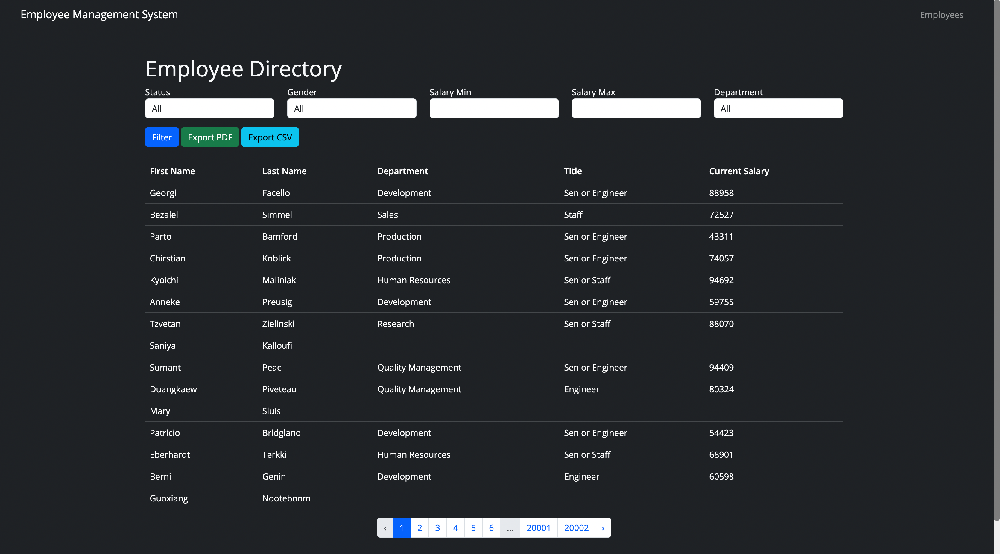
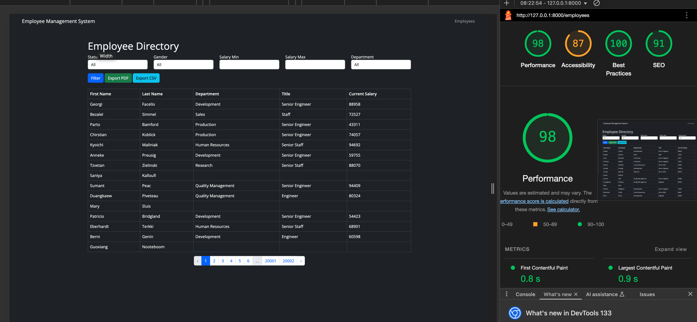
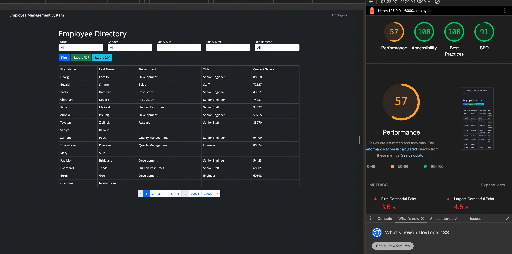

# Employee Directory

> 👥 **300 000 employees, one query at a time** — a Laravel front end for the MySQL Employees sample database, with filters that hold across exports

**Employee Directory** puts a readable interface on the MySQL Employees sample database — the one with six tables, three hundred thousand people and forty years of salary history. It lists them with pagination, narrows the list by department, gender, salary range and employment status, and opens a single person's record with their titles, departments and pay over time.

Whatever the filters say is what gets exported. Both the PDF and the CSV are built from the same query as the page you are looking at, so an export is never a different set of rows than the one on screen.


---

## 🎯 Key Features

- **Filters that compose** — department, gender, salary floor, salary ceiling and current-versus-former employment narrow the same query together; each one is a `whereHas` on the related table rather than a second round trip.
- **Exports match the screen** — PDF (dompdf) and CSV are generated from the filtered query, so what you download is what you were looking at. A separate check endpoint reports how many rows a PDF would contain before you commit to generating it.
- **One person, their whole history** — a record shows current and past departments, the sequence of job titles and the salary changes behind them, read from `titles`, `dept_emp` and `salaries`.
- **Paginated by design** — fifteen rows a page against a table of three hundred thousand; nothing tries to hold the set in memory.
- **A per-employee PDF** — a single record exports on its own, for when the whole list is not the point.
- **Accounts** — registration and sign-in through Laravel's own authentication, so the directory is not open to the world by default.
- **Measured** — Lighthouse reports for desktop and mobile are in `docs/lighthouse`.

---

## 🖼️ Screenshots

| The list with filters applied                   | A single employee record                       |
| ----------------------------------------------- | ---------------------------------------------- |
|  |  |

| Lighthouse, desktop                              | Lighthouse, mobile                             |
| ------------------------------------------------ | ---------------------------------------------- |
|  |  |

---

## 🗄️ The Database

This project does not invent its data. It reads the **MySQL Employees Sample Database**, a public dataset published for exactly this kind of exercise:

| Table       | Rows      | What it holds                                    |
| ----------- | --------- | ------------------------------------------------ |
| `employees` | ~300 000  | Person, birth date, hire date, gender.           |
| `salaries`  | ~2.8 M    | Pay with a validity range — history, not a field. |
| `titles`    | ~440 000  | Job titles over time.                            |
| `dept_emp`  | ~330 000  | Which department, and when.                      |
| `dept_manager` | ~24    | Who ran which department, and when.              |
| `departments`  | 9      | The departments themselves.                      |

The entity-relationship diagram is in `docs/ERD.png`.

Because salary and title are historical, "current" means "the row whose validity range has not ended" — which is why the models expose `currentSalary` and `currentDepartment` rather than a plain column.

---

## 🛠️ Technology Stack

| Technology              | Version | Role                                                         |
| ----------------------- | ------- | ------------------------------------------------------------ |
| **Laravel**             | 11      | Routing, Eloquent, Blade views, authentication.              |
| **PHP**                 | 8.2     | Runtime.                                                     |
| **MySQL**               | 8       | The Employees sample database.                               |
| **barryvdh/laravel-dompdf** | 3.1 | PDF export of the filtered list and of single records.       |
| **Laravel Sanctum**     | 4       | Session and token guards.                                    |
| **Blade**               | —       | Server-rendered views, no SPA layer.                         |

---

## 🚀 Getting Started

### Prerequisites

- PHP 8.2 or newer with Composer
- MySQL 8 (or MariaDB)
- The [MySQL Employees Sample Database](https://github.com/datacharmer/test_db)

### 1. Clone the repository

```bash
git clone https://github.com/dawidolko/Employees-List-Project-Laravel.git
cd Employees-List-Project-Laravel/backend
```

### 2. Install and configure

```bash
composer install
cp .env.example .env
php artisan key:generate
```

Point `.env` at the imported sample database:

```env
DB_DATABASE=employees
DB_USERNAME=root
DB_PASSWORD=
```

### 3. Load the data

```bash
# from the test_db checkout
mysql -u root -p < employees.sql
```

Then add this project's own tables (accounts, sessions):

```bash
php artisan migrate
```

### 4. Run

```bash
php artisan serve      # http://127.0.0.1:8000
```

---

## 📁 Project Structure

```
Employees-List-Project-Laravel/
├── backend/                            # the Laravel application
│   ├── app/
│   │   ├── Http/Controllers/
│   │   │   ├── EmployeeController.php  # list, filters, record, PDF and CSV exports
│   │   │   └── AuthController.php      # registration and sign-in
│   │   └── Models/
│   │       ├── Employee.php            # currentSalary, currentDepartment
│   │       ├── Salary.php              # validity range, not a single figure
│   │       ├── Title.php
│   │       ├── Department.php
│   │       └── DeptEmp.php
│   ├── resources/views/
│   │   ├── employees/                  # list, record and the PDF template
│   │   └── layouts/
│   └── routes/web.php
├── database/                           # SQL dump for a quick import
└── docs/                               # ERD, documentation, screenshots, Lighthouse
```

---

## 📄 License

MIT © [Dawid Olko](https://dawidolko.pl)
